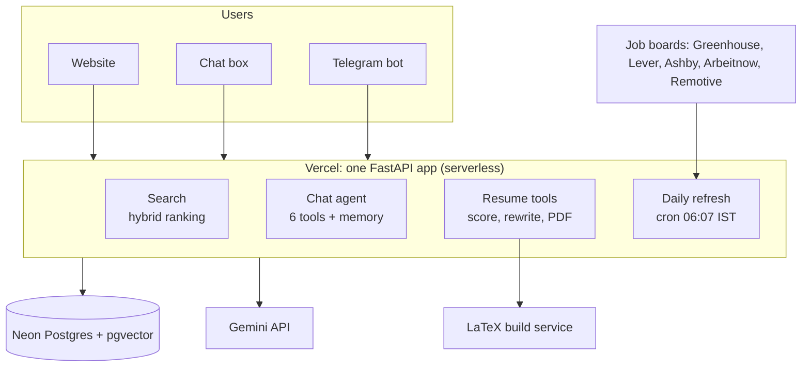
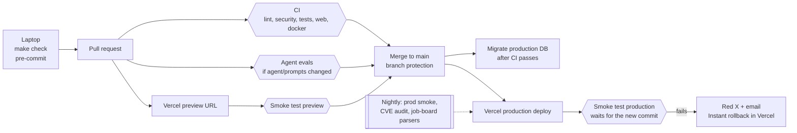

# ProofPath architecture: from a laptop to production

## 1. The running system

| Layer | What | Where |
|---|---|---|
| Web + API | FastAPI, one serverless function, static page | Vercel |
| Data | Jobs (one copy each), embeddings, job skills, role reports, chat memory | Neon Postgres 18 + pgvector |
| AI | Structured extraction, chat with function calling | Gemini (visitor's own key, or the server key) |
| Jobs in | Daily cron fetches, de-duplicates, embeds only changed postings | Vercel cron |

Personal data: resumes and API keys are never stored; chat memory, GitHub checks and Telegram
chats without alerts are deleted after a day (`app/retention.py`).

## 2. From a change to production

### Environments

| Environment | Where | Database | Deployed by |
|---|---|---|---|
| Local | `make db && make run` (Docker Postgres) | local `jobpilot` | you |
| CI | GitHub Actions runners | throwaway pgvector container | every push / PR |
| Preview | Vercel preview URL per pull request | production Neon (read-mostly) | Vercel, on every PR push |
| Production | proofpath-ganeshpokharkars-projects.vercel.app | Neon `proofpath-db` | Vercel, on merge to `main` |

### Pipelines (`.github/workflows/`)

| Workflow | When | What it guards |
|---|---|---|
| `ci.yml` | every PR and push to main | Lint and format (ruff); dependency CVEs (pip-audit), static security scan (bandit), committed secrets (gitleaks); 123 tests against real Postgres + pgvector with ≥80% coverage; migrations up, down and up again on an empty database; page scripts parse; Docker image builds and the stack answers `/health`. One summary job, `ci-passed`, is what branch protection requires. On main it then runs `alembic upgrade head` against production (when `PRODUCTION_DATABASE_URL` is set). |
| `evals.yml` | changes to the agent, prompts, model settings, search or evals | 100 fixed cases against the real model: tool-choice accuracy, filter extraction, hallucinated-job rate. Below `evals/thresholds.json` the check fails. |
| `deploy.yml` | every Vercel deployment that goes live (preview and production) | Waits until `/version` reports the new commit, then `scripts/smoke.py` checks health, the page, India search, filters, job details, stats, chat memory and that admin routes stay locked. |
| `nightly.yml` | 02:47 IST daily | Production smoke test, new CVEs in pinned dependencies, and whether each job-board API still parses. |
| Dependabot | weekly | Grouped dependency update PRs, which go through all of the above. |

### Schema changes

1. Write an Alembic migration in `migrations/versions/`.
2. CI applies it to an empty database, rolls it back and applies it again.
3. After merge, the `migrate` job applies it to production before traffic needs it.
4. Additive steps the app cannot run without are also in `app/schema_live.py`, which the app
   applies on start only when missing (each step in its own short transaction), so a deploy
   never runs ahead of the database even without the migrate secret.

### Rollback

Vercel keeps every deployment. If the production smoke test fails: Vercel dashboard →
Deployments → the last green one → **Instant Rollback** (seconds, no rebuild). Migrations are
additive, so the previous code runs against the newer schema.

### One-time setup in GitHub and Vercel

- **Branch protection** (GitHub → Settings → Branches → `main`): require a pull request and the
  `ci-passed` check, so a red build can never reach production.
- **Vercel Deployment Checks** (Vercel → Settings → Deployment Checks): add `ci-passed`, so
  Vercel builds production on merge but only promotes it once CI is green.
- **Secrets** (GitHub → Settings → Secrets → Actions): `GEMINI_API_KEY` (a separate key for
  evals, so they never use the live site's quota) and optionally `PRODUCTION_DATABASE_URL`.
